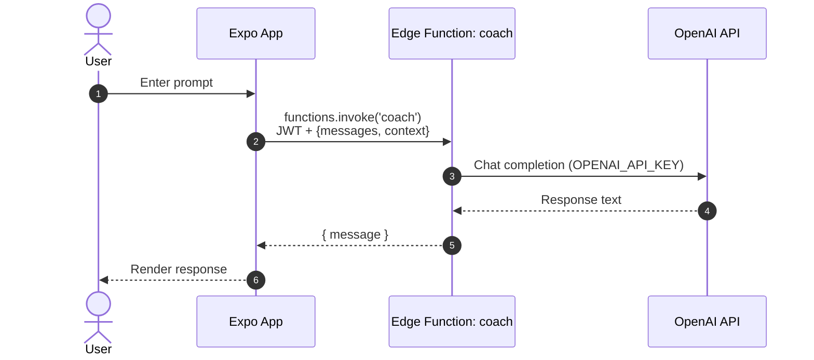
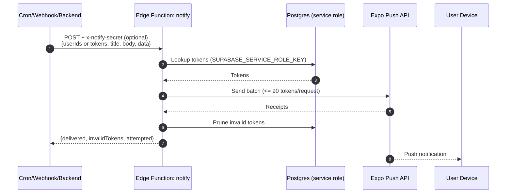

# Form Factor 💪

Form Factor is an iOS-first fitness and health app built with Expo and Supabase. It gives real-time form cues from the phone camera—counting reps, flagging issues (e.g., swing on pull-ups, squat depth), and auto-logging sets—to improve outcomes and reduce injury. It also delivers fast offline workout/food logging, HealthKit-powered trends, video and form capture, AI coaching with dispatch guardrails, and an experimental ARKit body-tracking flow. Web is mostly display-first.

## What it does
- Tracking: Offline-first foods and workouts using SQLite with sync queue, realtime backfill, conflict handling, and soft delete to Supabase.
- Health: HealthKit permissions, summaries (steps, HR, weight), trend analysis, and historical bulk sync to Supabase; watch connectivity helpers included.
- Form & media: ARKit body-tracking tab with pull-up/push-up rep detection, confidence and occlusion feedback, calibration/debrief recovery flows, speech cues, Vision Camera overlays, video capture/upload to Supabase Storage, and a feed with signed URLs plus comments.
- Coach & notifications: AI coach backed by Supabase Edge Functions with provider dispatch, task-kind routing, retry/cost guardrails, offline queueing, push token registration/preferences, and Edge Function `notify` for Expo push delivery.
- UI/Navigation: Expo Router tabs, React Native Paper components, accessibility labels/hints, haptic feedback, keyboard-friendly forms, and Playwright smoke coverage for the web target.

## Status and roadmap
- Implemented: offline foods/workouts, HealthKit summaries/trends, video upload + feed, AI coach dispatch/cost controls, push notification plumbing, Playwright auth flow, broad Jest coverage, Fusion Engine (v1), and form-tracking UX resilience across calibration, live sessions, and debriefs.
- In progress: ARKit body-tracking polish (see `docs/ARKIT_BODY_TRACKING_GUIDE.md`) and metrics upload, broader end-to-end coverage, telemetry/error-handling hardening, and TestFlight readiness.
- Planned: Richer social/feed interactions, ML recommendations, production push campaigns, and continued coach model-routing evaluation.

## Repository layout

The root package is the Expo mobile app. Bun workspaces also include the Next.js web app, shared TypeScript code, and native modules.

| Path | Purpose |
|------|---------|
| `app/` | Expo Router screens and navigation layouts |
| `features/` | Feature-owned mobile components, hooks, providers, and styles |
| `components/`, `contexts/`, `hooks/` | Shared UI primitives, app-wide providers, and generic hooks |
| `lib/` | Mobile services and domain logic, including `fusion/`, `tracking-quality/`, and `workouts/` |
| `styles/`, `types/`, `assets/` | Shared theme styles, type declarations, and bundled assets |
| `apps/web/` | Next.js web app with its own routes, configuration, and tests |
| `packages/shared/` | Shared TypeScript code for workspace consumers |
| `modules/` | Native workspace packages: ARKit body tracker, HealthKit, and watch connectivity |
| `ios/`, `android/`, `native/`, `targets/`, `plugins/` | Platform projects, native source, Apple targets, and Expo config plugins |
| `supabase/` | Database migrations and Edge Functions |
| `etc/` | Shared tooling and app configuration; root entry files delegate here where supported |
| `scripts/` | Development, build, evaluation, and CI automation; CI policy helpers live in `scripts/ci/` |
| `tests/`, `evals/` | Automated tests, fixtures, and model evaluations |
| `docs/` | Guides, runbooks, architecture notes, and implementation plans |

Keep route files in their app's routing directory. Put feature-owned UI and orchestration in `features/<feature>/`, shared UI primitives in `components/`, and reusable engines, services, and infrastructure in `lib/`. Cross-app code belongs in `packages/shared/` and native module implementations in `modules/`. Keep app-specific configuration with its workspace and shared tooling configuration in `etc/`.

Feature folders cover `auth`, `coach`, `form-tracking`, `health`, `nutrition`, `onboarding`, `profile`, `social`, `voice`, and `workouts`. Import files directly through `@/features/<feature>/...`; see [the feature organization guide](docs/REPOSITORY_STRUCTURE.md) for ownership and placement rules.

## Quick Start

For a detailed setup guide, see [docs/DEVELOPER_ONBOARDING.md](docs/DEVELOPER_ONBOARDING.md).

1.  **Install**: `bun install`
2.  **Env**: `cp .env.example .env.local` (fill in Supabase/Expo keys)
3.  **Run**: `bun run ios` (Simulator) or `bun run ios:device` (Physical Device)

## EAS Build Policy
- `eas build` does **not** run for pull requests; paid builds happen on `main` after merge (and on `develop` if you keep staging deploys automatic).
- Deploy jobs are gated by workflow policy checks, blocking security checks, and deploy preflight validation.
- Husky `pre-push` always runs `python3 scripts/ci_local.py --quick`. Local iOS preview builds run by default on `main`/`develop`, and can be enabled on feature branches with `CI_LOCAL_RUN_EAS_PREVIEW_LOCAL=1`.
- You can run `bun run ci:push` anytime to reproduce the hook, or `bun run preview:local:submit` to build locally and upload/submit the same `.ipa`.

## Testing and QA
- Lint/types: `bun run lint`, `bun run check:types`, `bun run check:dead-code`.
- Unit: `bun run test` (Jest + Testing Library).
- E2E (web target): `bun run test:e2e` (Playwright + Bun).
- E2E in Docker: `bun run test:e2e:docker` (containerized testing).
- E2E with UI: `bun run test:e2e:ui` (interactive debugging).

See [TESTING.md](TESTING.md) for detailed testing documentation.

## Backend (Supabase)

### Edge Functions (request flow)

### Source-of-truth links
- Migrations / schema: `supabase/migrations/`
- Storage policies: `supabase/migrations/012_create_video_buckets.sql`
- Coach guide: `docs/COACH_FUNCTION.md`
- Edge function code: `supabase/functions/coach/index.ts`, `supabase/functions/notify/index.ts`

## Documentation
- **Start Here**: `docs/DEVELOPER_ONBOARDING.md`.
- Repo standards and commands: `docs/AGENTS.md`.
- ARKit: `docs/ARKIT_BODY_TRACKING_GUIDE.md`.
- HealthKit sync/trends: `docs/HEALTHKIT_SYNC_AND_TRENDS_GUIDE.md` and `docs/HEALTHKIT_SYNC_QUICK_START.md`.
- Platform-specific/native tips: `docs/PLATFORM_SPECIFIC_CODE_GUIDE.md`, `docs/WATCH_APP_GUIDE.md`.
- CI/CD and releases: `docs/CI-CD.md`, `docs/TESTFLIGHT_WORKFLOW.md`, `docs/TESTFLIGHT_RELEASE.md`.
